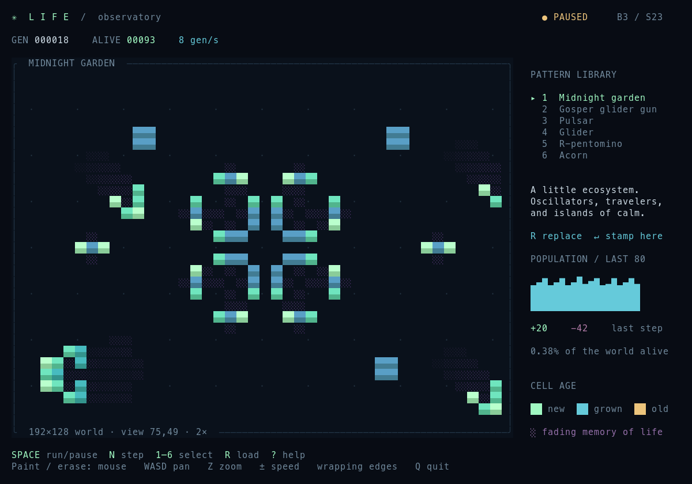
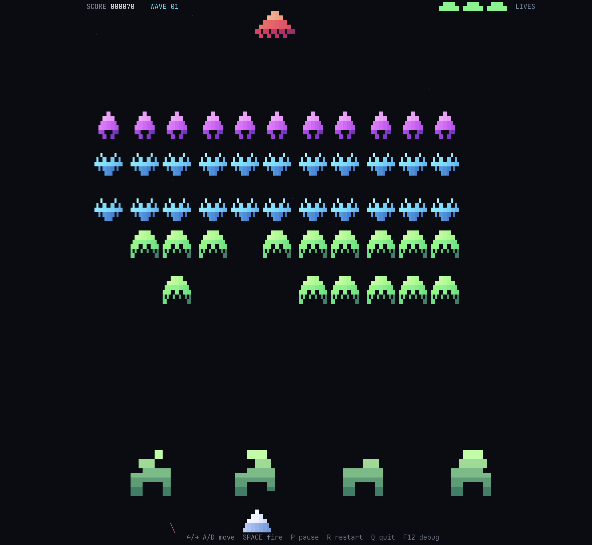
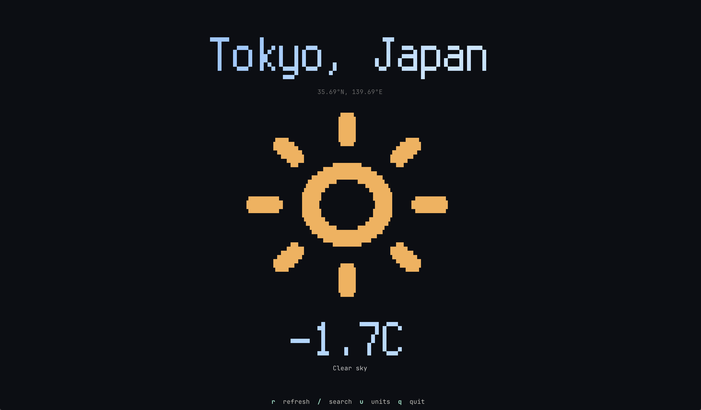
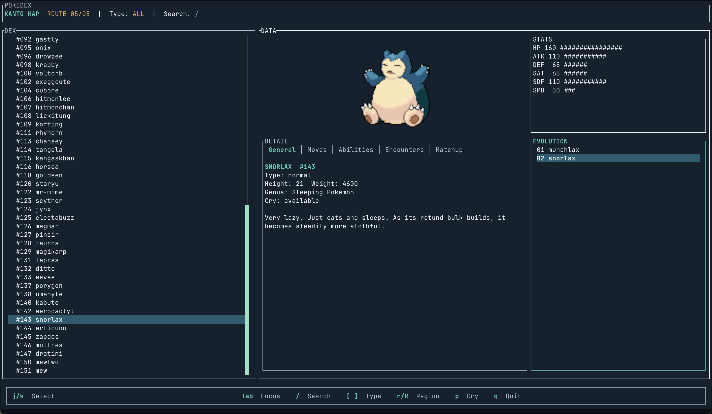
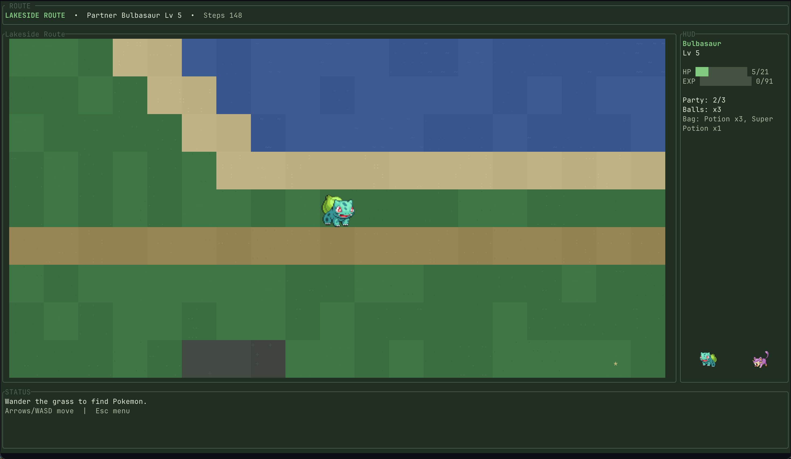
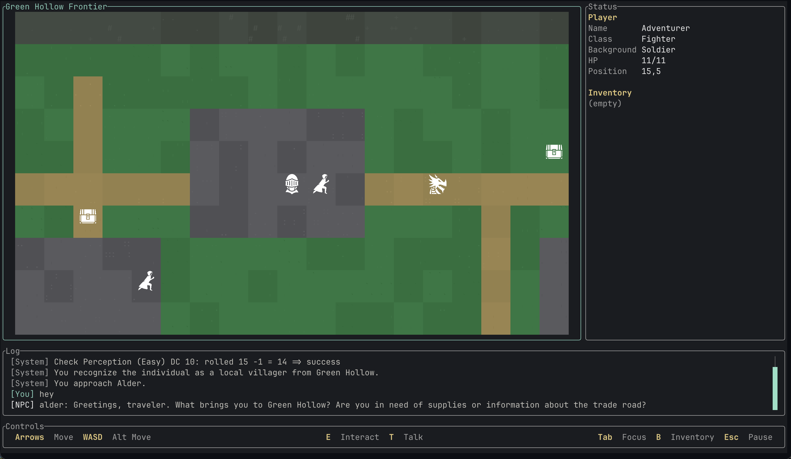
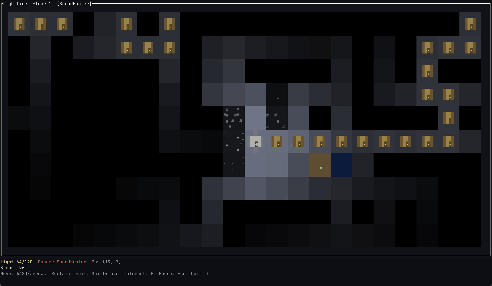

# TUI Stuff

Random TUI projects, probably built with [tui-dispatch](https://github.com/dmk/tui-dispatch).

> **Note:** These are creative sketches only, not ready for use.

## Projects

### [game-of-life](./game-of-life)
Conway's Game of Life: age-colored cells, fading trails, pattern planting, and replayable experiments

### [space-invaders](./space-invaders)
Well, space invaders. Probably best played in ghostty for better key responsiveness.

### [weather](./weather)
Terminal weather app using Open-Meteo API

### [pokeapi](./pokeapi)
Browse Pokemon info using [PokeAPI](https://pokeapi.co/)

### [poketui](./poketui)
Actual Pokemon game in the terminal

### [dndtui](./dndtui)
D&D terminal interface with LLM-powered dungeon master

### [lightline](./lightline)
Dungeon exit game with limited light

