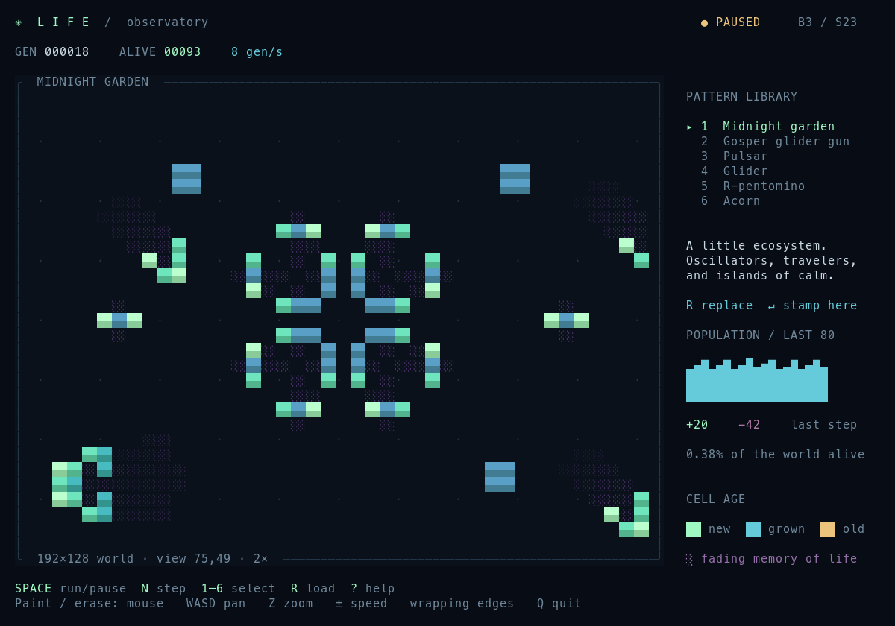

# Life

A small cellular observatory for Conway's Game of Life, built with
**tui-dispatch 0.7.1** and **Ratatui 0.30**. Mint newborns grow through teal and
blue into gold; vanished cells leave a fading violet memory. A population
sparkline tracks the last 80 generations.



```sh
cargo run --manifest-path game-of-life/Cargo.toml
```

Run commands from the repository root. The midnight garden opens running at
8 generations per second. Press **Space** to pause, **1–6** to choose a pattern,
then **R** to replace the world or **Enter** to stamp it at the cursor. **?**
opens field notes with every control.

The world is **192×128 cells**, with wrapping edges by default. Pan to explore;
three zoom levels use 1×1, 2×1, or 4×2 terminal cells per world cell. The default
2×1 view makes cells approximately square. The pattern sidebar appears at
105 columns. At least **60×22** is required; smaller windows suspend the clock
without losing the world. Resizing changes the view, never the simulation grid.

## Controls

| Key | Action |
| --- | --- |
| Space | Run / pause |
| N | Advance one generation and pause |
| + / - | Change speed, from 1 to 60 generations per second |
| 1–6 | Select garden, Gosper gun, pulsar, glider, R-pentomino, or acorn |
| R | Replace the world with the selected pattern; reset generation and camera |
| Enter | Stamp the selected pattern at the cursor |
| Arrows | Move the editor cursor; camera follows when needed |
| X | Toggle the cell at the cursor |
| Left click / drag | Paint living cells |
| Right click / drag | Erase cells |
| WASD / mouse wheel | Pan the camera |
| Home / 0 | Recenter the camera and cursor |
| Z | Cycle zoom |
| C | Clear the world |
| F | Fill the world with deterministic 24% random soup |
| B | Switch between wrapping and fixed, dead boundaries |
| G / T | Toggle grid dots / trails |
| ? / Escape | Open / close help; help suspends the clock |
| Q / Ctrl-C | Quit |
| F12, with `--debug` | Inspect actions, state, and frame cells |

Painting, stamping, loading, clearing, and randomizing pause the simulation.
Patterns clip at world edges. Selecting a pattern alone does not change cells.
Cell age and trails are visual only: the simulation always follows B3/S23.
Gold marks cells older than 30 generations; trails fade over 12 generations.

## JSON actions → resulting frame

The same actions drive keyboard input, mouse input, and scripted rendering.
No live timer is started for a replay or a headless frame.

```sh
# A colorful garden after exactly 18 generations:
cargo run --manifest-path game-of-life/Cargo.toml -- \
  --debug-actions-in game-of-life/scenarios/garden.json \
  --debug-render-once

# Watch the glider gun's final state in a wider frame, and save its snapshot:
cargo run --manifest-path game-of-life/Cargo.toml -- \
  --debug-actions-in game-of-life/scenarios/gun.json \
  --debug-render-once --width 144 --height 48 \
  --debug-state-out /tmp/life.json
```

For example, a complete editor session can be described as:

```json
[
  "Clear",
  { "PatternSelect": "Glider" },
  "PatternStamp",
  { "Advance": 4 },
  { "CellSet": { "x": 110, "y": 60, "alive": true } }
]
```

`Advance(n)` advances exactly `n` generations and pauses, regardless of speed.
`Tick` advances the fixed-point clock by 20 ms only while running, help is
closed, and the viewport is large enough. At the default speed, 50 ticks
produce eight generations. `Step` is equivalent to `Advance(1)`.

Other supplied scenes: `scenarios/soup.json` and `scenarios/editor.json`.
Headless output is a plain-text terminal frame; RGB colors are verified in
the render tests against the actual Ratatui buffer.

```sh
# Record an interactive session, including clock ticks:
cargo run --manifest-path game-of-life/Cargo.toml -- \
  --debug-actions-out /tmp/life-actions.json

# Replay it using the same seed (the default is deterministic):
cargo run --manifest-path game-of-life/Cargo.toml -- \
  --debug-actions-in /tmp/life-actions.json --debug-render-once

# Resume a snapshot, or export JSON schemas:
cargo run --manifest-path game-of-life/Cargo.toml -- --debug-state-in /tmp/life.json
cargo run --manifest-path game-of-life/Cargo.toml -- \
  --debug-render-once \
  --debug-state-schema-out /tmp/life-state-schema.json \
  --debug-actions-schema-out /tmp/life-actions-schema.json
```

Use the same `--seed`, `--width`, and `--height` when comparing recordings.
Interactive replay stays frozen after its actions finish; normal play starts
the live subscription. Snapshots include ages, trails, history, camera, editor
state, and random generator state, and are validated before use.

## Architecture and checks

One subscription dispatches `Tick` every 20 ms. The pure reducer owns all
simulation and editor changes and returns `NoEffect`. Evolution counts
neighbors from the old generation before updating any cells. Rendering only
reads state. No per-cell tasks, wall-clock reads, or unseeded randomness.

```sh
cargo fmt --manifest-path game-of-life/Cargo.toml --check
cargo test --manifest-path game-of-life/Cargo.toml
cargo clippy --manifest-path game-of-life/Cargo.toml --all-targets -- -D warnings
```

Tests cover canonical patterns, boundary behavior, clock suspension and speed,
trails, seeded evolution, snapshots, mouse coordinates, responsive rendering,
RGB styles, and the complete CLI recording/replay path.
