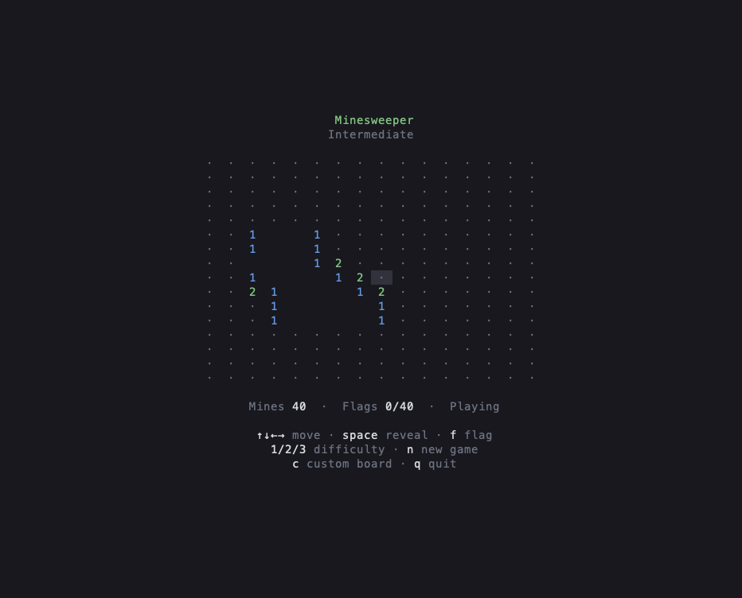

# Minesweeper

Standalone native port of the Rust Minesweeper in `dkoval.pro`'s terminal
playground, built with **tui-dispatch 0.7.1** and **Ratatui 0.30**.
It keeps the centered board, terminal background, compact controls, and
borderless custom-game form.



Run from the repository root:

```sh
cargo run --manifest-path minesweeper/Cargo.toml
# Start at intermediate (2) or expert (3):
cargo run --manifest-path minesweeper/Cargo.toml -- --difficulty 2
```

| Key / input | Action |
| --- | --- |
| Arrows / HJKL | Move cursor; large boards scroll to follow |
| Space / Enter / left click | Reveal |
| F / right click | Toggle flag |
| 1 / 2 / 3 | Beginner (9×9, 10 mines), intermediate (16×16, 40), expert (24×20, 99) |
| N | New board at the current difficulty |
| C | Custom board: 5–120 columns and rows; 1–30% mines |
| Tab / Shift-Tab / Up / Down | Select custom field |
| Enter / Escape in form | Start / cancel |
| Q / Escape | Quit |
| Ctrl-C | Quit, including from the form |
| F12 with `--debug` | Inspect actions, state, and frame cells |

The first successful reveal is always safe: a mine under it moves to a safe
cell, preserving the mine count and any flags. Empty areas expand one ring
every 40 ms. Flags block reveals, and the custom form pauses the animation.
New games and difficulty changes discard pending reveal waves.

The custom form supports typing to replace initial values, cursor editing,
click-to-focus, and validation. Boards larger than the viewport scroll with
the keyboard cursor; mouse targets use the same layout as rendering.

```sh
# Render a plain-text frame without opening a terminal:
cargo run --manifest-path minesweeper/Cargo.toml -- --debug-render-once

cargo fmt --manifest-path minesweeper/Cargo.toml --check
cargo test --manifest-path minesweeper/Cargo.toml
cargo clippy --manifest-path minesweeper/Cargo.toml --all-targets -- -D warnings
```

The standard debug CLI supports action recording, state snapshots, schema
exports, and headless action files. Boards and first-mine relocations use
randomness; recordings alone do not reproduce the initial board. Reveal-wave
queues live in middleware and are not included in state snapshots.
